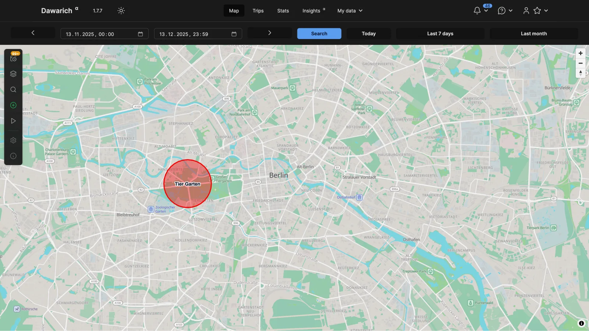

# Map

The Map page provides interactive visualizations of your location data. You can view points, routes, heatmaps, and various other layers to explore your travel history.

## One Map

Dawarich has one map, built on MapLibre GL JS. It renders with WebGL, supports a 3D globe, built-in place search (see [Search](/docs/features/search)) and several map styles. The old Leaflet map (Map V1) has been removed: `/map/v1` now redirects to the current map.

## Map Interface

### Time Range Selection

Use the date picker at the top to select the time range for displayed data. You can view data from a single day to your entire history.

### Map Buttons

The buttons on the left edge of the map open its panels. Each has a keyboard shortcut:

| Button | Shortcut | Opens |
|--------|----------|-------|
| Timeline | `T` | Your days and visits for the selected dates |
| Layers | `L` | Map layers and their options |
| Search | `/` | [Place search](/docs/features/search) |
| Family | `F` | Family members on the map (only when you are in a [family](/docs/features/family)) |
| Tools | `C` | Create visits, places and areas, select points, enrich photos |
| Replay | `R` | Replay the points for the selected dates |
| Settings | `S` | [Map settings](#map-settings) |

Poster Studio, Video Studio and Links are in the same strip.

### Point Details

Click on any point to see:
- Timestamp
- Coordinates
- Altitude (if available)
- Speed (if available)
- Battery level (if recorded)

### Route Details

Hover over or click on a route to see:
- Total distance
- Duration
- Average speed
- Transportation mode (if detected)

## Map Layers

Open **Layers** (`L`) to turn layers on and off. Layers are shown as tiles: click a tile to switch the layer on, and the options for the layers that are on appear below the tiles. The Anomalies layer is only available while Points is on.

### Points

Shows individual GPS points on the map as markers.

### Tracks

Displays your tracks connecting GPS points. Dawarich builds tracks on the server, starting a new one when the time or distance gap set under **Settings → Track generation** is exceeded.

### Heatmap

Visualizes point density as a heatmap, showing areas where you spend the most time.

### Fog of War

Shows unexplored areas as "fog," revealing only the regions you've visited. Great for visualizing your travel coverage.

### Visited Countries

Highlights the countries you visited in the selected date range.

### Areas

Shows [custom areas](/docs/features/areas) you've drawn on the map. Also enables area drawing tools.

### Flights

Shows flights synced from [AirTrail](/docs/features/stats) as arcs, hiding the GPS points recorded during the flight.

### Visits and Places

**Visits** shows your detected and confirmed [visits](/docs/features/visits-and-places), with filters for confirmed or suggested ones. **Places** shows your saved places, filterable by name and tag.

### Hexagons

Shows point density as hexagonal cells.

### Anomalies

Shows the points hidden as GPS noise. Available while Points is on.

### Photos

Displays photos from connected [Immich and/or Photoprism](/docs/features/photos) instances at their GPS locations.

### Family

When you are in a [family](/docs/features/family), open the **Family** tab (`F`) and switch on **Show family member locations** to see the members who share their location with you. Their positions update in real time, and for members who also share their location history, their track is drawn for the dates selected on the map.

The tab lists every sharing member with their last known address and when they were last seen. Click a member to center the map on them, or use **Manage family** to open the Family page.

## Tools

Open **Tools** (`C`) to:

- **Create Visit** and **Create Place** at a spot on the map
- **Select Area** to select points for [bulk actions](#bulk-selection-tool)
- **Create Area** to draw a [custom area](/docs/features/areas)
- **Enrich Photos** to match [Immich](/docs/features/enrich-photos) photos without GPS to your location history

## Map Styles

Choose a style under **Settings → Appearance → Map Style**: Light, Dark, White, Black, Grayscale or Custom. **Customize colors** changes individual map colors, and **Base Map Layers** switches roads, labels, buildings, points of interest and other base map elements on or off. Custom map colors and layer colors are Pro features; on the Lite plan you can preview them.

## Speed-Colored Tracks

Turn on **Color tracks by speed** under **Settings → Layer Colors** to color your tracks by speed, from slow (walking, cycling) to fast (driving). Use **Edit speed colors** to adjust the scale to your typical travel speeds.

## Globe View

Turn on **Globe View** under **Settings → Appearance** to render the map as a 3D globe instead of a flat projection. The change applies after the page reloads. Globe View is a Pro feature.

## Live Mode

Turn on **Live Mode** in Settings to show new points on the map as they are recorded.

## Editing Points

To correct GPS drift or an inaccurate reading, open **Layers**, and in the Points options turn on **Edit points**. Then drag a point to its new position. Editing points is available on the Pro plan.

## Bulk Selection Tool

Select multiple points at once:

1. Open **Tools** (`C`) and choose **Select Area**
2. Draw a rectangle around points to select
3. Perform bulk actions (delete, export, etc.)

## Map Settings

Open map settings with the **Settings** button (`S`) on the left edge of the map. Available settings include:

| Setting | Description |
|---------|-------------|
| Appearance | Map style, custom colors and Globe View |
| Layer Colors | Track colors, Color tracks by speed and the speed color scale |
| Distance Unit | Kilometers or miles |
| Custom Basemap URL | Serve the base map from your own tile source |
| Base Map Layers | Show or hide roads, labels, buildings, points of interest and other base map elements |
| Track generation | Distance and time gaps that start a new track, and **Recalculate tracks & stats** |
| Fog of War | Radius cleared around visited points, and the minimum number of points to clear fog |
| GPS Noise Filtering | Hide readings that cannot be a real position, and re-evaluate past data |
| City Statistics | How long you must stay in a city for it to count in statistics |
| Live Mode | Show new points in real time |
| Transportation Mode Detection | Which modes are detected, and re-classify your history |

## Search

The map includes a built-in place search. See the [Search documentation](/docs/features/search) for details.

## Tips

- **Performance**: For large datasets, disable layers you're not using
- **Time ranges**: Start with shorter time ranges and expand as needed
- **Zoom levels**: Some layers render differently at various zoom levels
- **Mobile**: Pinch to zoom, two-finger drag to rotate
