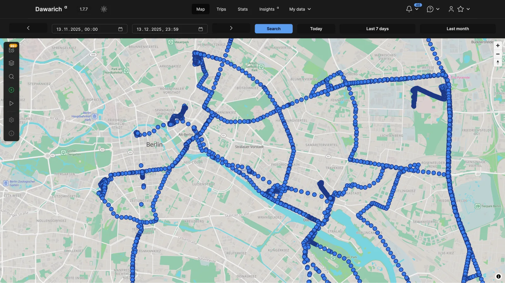
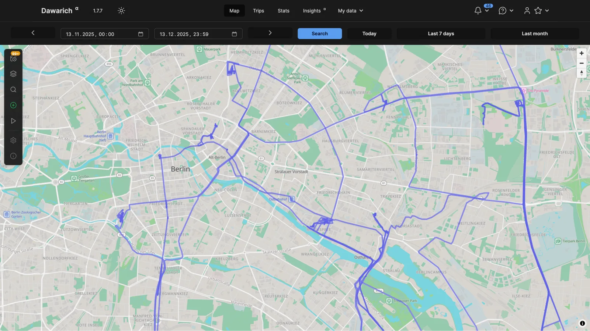
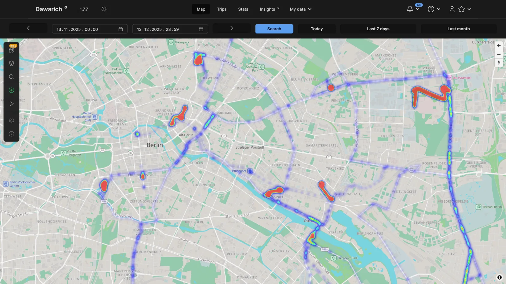
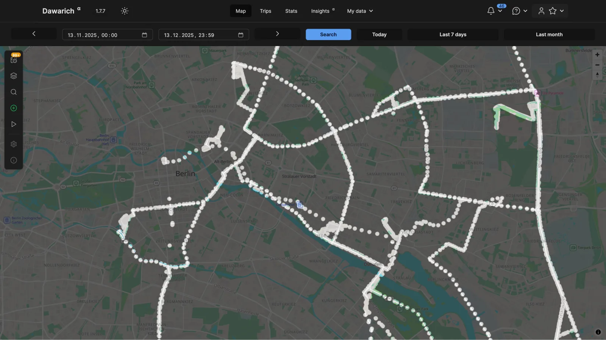
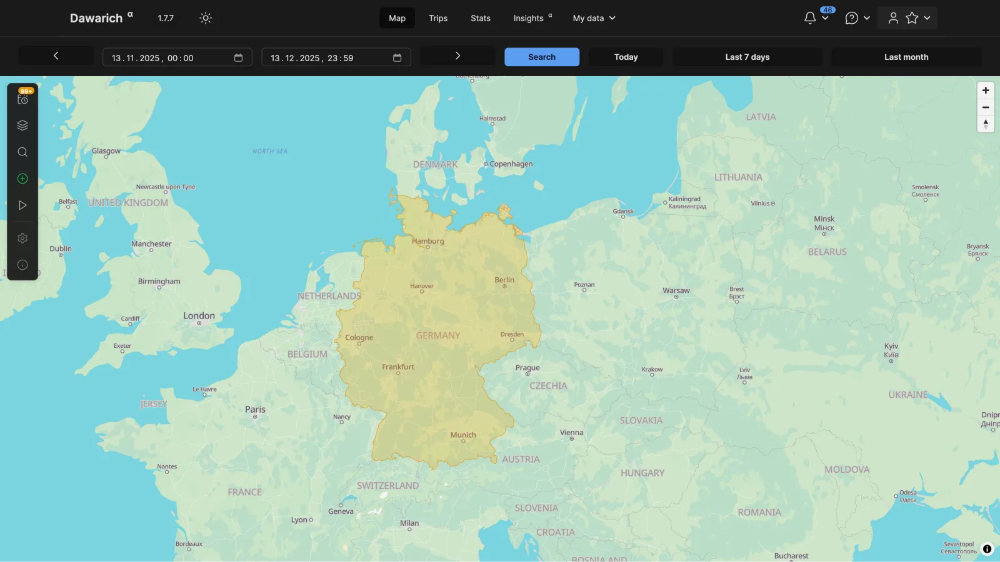
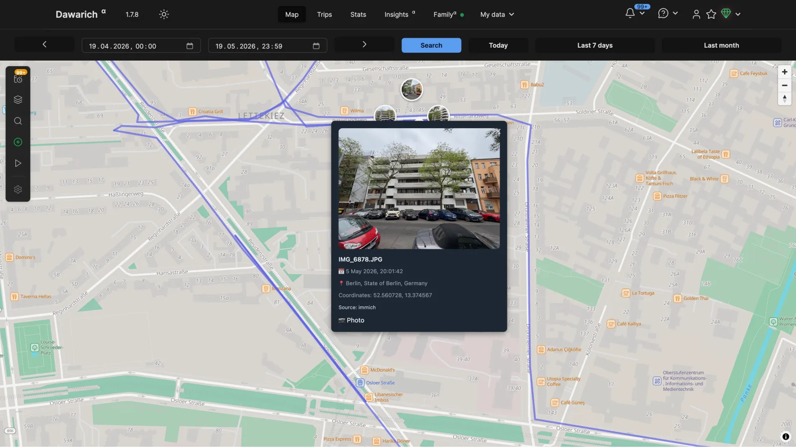
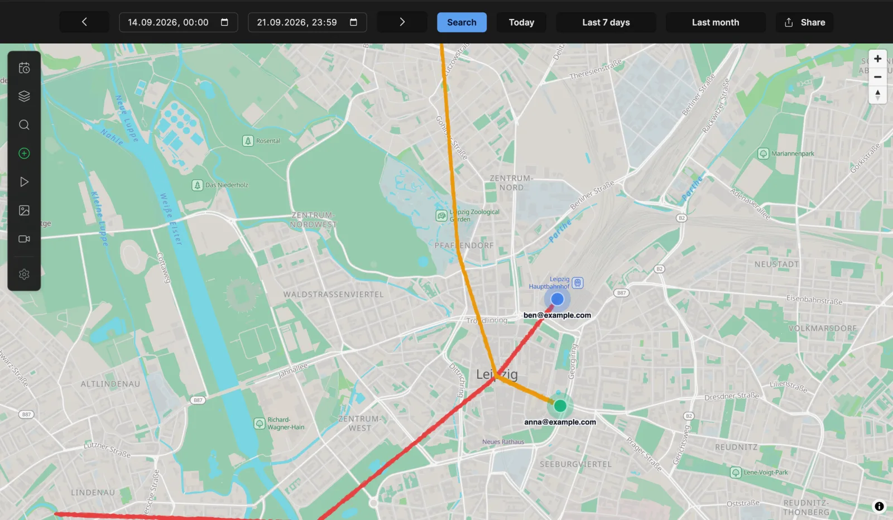

# Map

The Map page provides interactive visualizations of your location data. You can view points, routes, heatmaps, and various other layers to explore your travel history.

## One Map

Dawarich has one map, built on MapLibre GL JS. It renders with WebGL, supports a 3D globe, built-in place search (see [Search](/docs/features/search)) and several map styles. The old Leaflet map (Map V1) has been removed: `/map/v1` now redirects to the current map.

## Map Interface

### Time Range Selection

Use the date picker at the top to select the time range for displayed data. You can view data from a single day to your entire history.

### Map Buttons

The buttons on the left edge of the map open its panels. Each has a keyboard shortcut:

| Button | Shortcut | Opens |
|--------|----------|-------|
| Timeline | `T` | Your days and visits for the selected dates |
| Layers | `L` | Map layers and their options |
| Search | `/` | [Place search](/docs/features/search) |
| Family | `F` | Family members on the map (only when you are in a [family](/docs/features/family)) |
| Tools | `C` | Create visits and places, select data on the map, enrich photos |
| Replay | `R` | Replay the points for the selected dates |
| Settings | `S` | [Map settings](#map-settings) |

Poster Studio, Video Studio and Links are in the same strip.

### Point Details

Click on any point to see:
- Timestamp
- Coordinates
- Altitude (if available)
- Speed (if available)
- Battery level (if recorded)

### Route Details

Hover over or click on a route to see:
- Total distance
- Duration
- Average speed
- Transportation mode (if detected)

## Map Layers

Open **Layers** (`L`) to turn layers on and off. Layers are shown as tiles: click a tile to switch the layer on, and the options for the layers that are on appear below the tiles. The Anomalies layer is only available while Points is on.

### Points

Shows individual GPS points on the map as markers.

### Polylines (Routes)

Displays your routes connecting GPS points. Routes are automatically generated based on your configured time and distance thresholds.

### Heatmap

Visualizes point density as a heatmap, showing areas where you spend the most time.

### Fog of War

Shows unexplored areas as "fog," revealing only the regions you've visited. Great for visualizing your travel coverage.

### Scratch Map

Highlights countries you've visited on a world map overlay.

### Places

Shows your [places](/docs/features/visits-and-places#places) with their names. The map shows places you created or imported, places with a tag or note, and places with a confirmed visit. Automatically found places without any of these stay on the Places page under **Unconfirmed**.

In the Places options below the tiles:

- **Show place boundaries** draws each place's Visit Radius as a circle. It is off by default.
- Tag filters show only places with the selected tags.

### Photos

Displays photos from connected [Immich and/or Photoprism](/docs/features/photos) instances at their GPS locations.

### Family

When you are in a [family](/docs/features/family), open the **Family** tab (`F`) and switch on **Show family member locations** to see the members who share their location with you. Their positions update in real time, and for members who also share their location history, their track is drawn for the dates selected on the map.

The tab lists every sharing member with their last known address and when they were last seen. Click a member to center the map on them, or use **Manage family** to open the Family page.

## Tools

Open **Tools** (`C`) to:

- **Create Visit** and **Create Place** at a spot on the map. A new place gets a Visit Radius, 50 meters unless you change it
- **Select data on map** to select points for [bulk actions](#bulk-selection-tool)
- **Enrich Photos** to match [Immich](/docs/features/enrich-photos) photos without GPS to your location history

## Map Styles

You can choose from multiple map styles:

- Light theme
- Dark theme
- Satellite imagery
- Multiple style variations

## Speed-Colored Routes

Enable "Fancy Routes" or "Speed Colored Routes" in settings to color your routes based on speed:

- **Green** - Slower speeds (walking, cycling)
- **Yellow** - Medium speeds
- **Red** - Higher speeds (driving)

The color scale is customizable to match your typical travel speeds.

## Globe View

The map supports 3D globe rendering:

1. Go to Settings
2. Enable "Globe Projection"
3. The map will render as a 3D globe instead of flat projection

This provides a more realistic view when zoomed out and is particularly striking for visualizing global travel.

## Live Map Mode

When enabled, Live Map Mode:
- Automatically updates with new points as they're recorded
- Centers the map on your most recent location
- Useful for real-time tracking

## Point Drag & Drop

You can drag points to adjust their position:

1. Enable point editing mode
2. Click and drag a point to a new location
3. The point's coordinates are updated

This is useful for correcting GPS drift or inaccurate readings.

## Bulk Selection Tool

Select multiple points at once:

1. Open **Tools** (`C`) and choose **Select data on map**
2. Draw a rectangle around points to select
3. Perform bulk actions (delete, export, etc.)

## Map Settings

Open map settings with the **Settings** button (`S`) on the left edge of the map. Available settings include:

| Setting | Description |
|---------|-------------|
| Preferred Map Layer | Default map style |
| Route Opacity | Transparency of route lines |
| Fog of War Meters | Resolution of fog tiles |
| Minutes Between Routes | Time gap to start a new route |
| Meters Between Routes | Distance gap to start a new route |
| Speed Colored Routes | Enable speed-based route coloring |
| Globe Projection | Enable 3D globe view |
| Live Map Enabled | Auto-update with new points |

## Search

The map includes a built-in place search. See the [Search documentation](/docs/features/search) for details.

## Tips

- **Performance**: For large datasets, disable layers you're not using
- **Time ranges**: Start with shorter time ranges and expand as needed
- **Zoom levels**: Some layers render differently at various zoom levels
- **Mobile**: Pinch to zoom, two-finger drag to rotate
