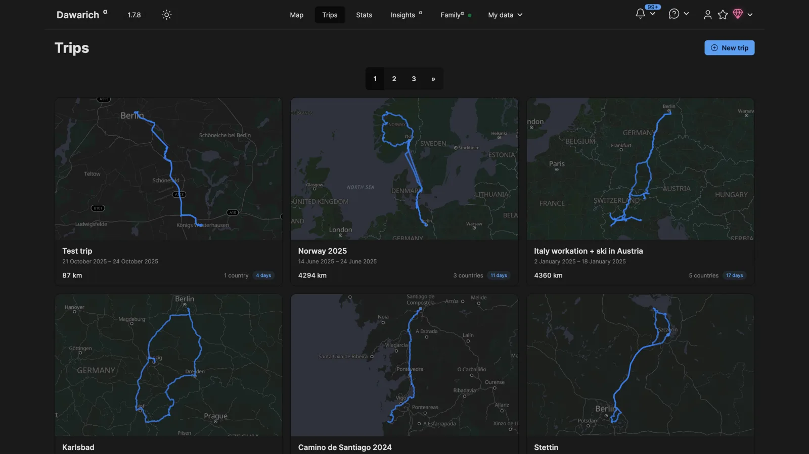
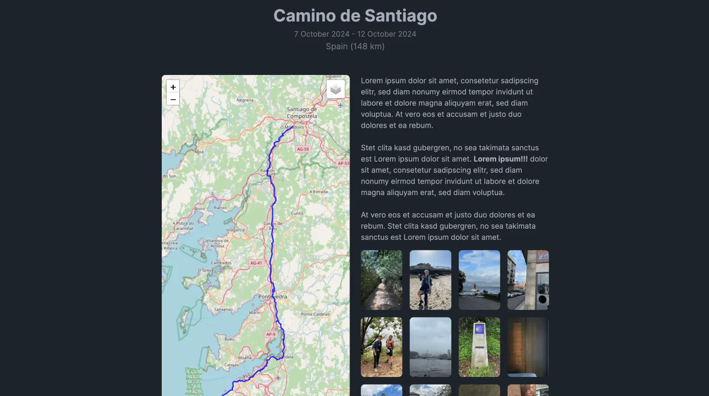

# Trips

Trips let you group your location history into named journeys with dates, notes, and a map of the route.

Trips planned in TREK can be imported and kept in sync. See [TREK](/docs/features/trek).

## Creating a trip

Click **New trip** and fill in:

- **Name** — a label for the trip (e.g. "Japan 2024")
- **Start date / End date** — the date range to include
- **Notes** — rich text field (supports formatting via the Trix editor)

Click **Create** to save. Dawarich automatically pulls in all points recorded within the date range.

## Trips list

The trips list shows all your saved trips in one place.

### Searching, sorting and filtering

Above the list you can narrow down your trips:

- **Search** - matches the trip name, its description, the countries it visited and its notes
- **Sort** - Newest first, Oldest first, Name (A–Z) or Longest distance
- **Year** and **Month** - show trips from a given year, or a month of that year (choose a year first)
- **Country** - show trips that visited a given country

Click **Apply** to update the list, or **Reset** to clear every filter. The filters are kept in the page address, so you can bookmark or share a filtered list.

## Trip detail page

Clicking a trip opens the detail view, which includes:

- **Date range** — start and end dates for the trip
- **Countries visited** — a breakdown of which countries you traveled through with distance covered in each
- **Interactive map** — your route plotted on a map for the trip's date range
- **Notes** — your formatted notes for the trip
- **Photos** — thumbnail previews pulled from connected photo services (Immich or PhotoPrism), with a link to view the full set

From the trip page you can also open the trip in [Poster Studio](/docs/features/poster-studio) or [Video Studio](/docs/features/video-studio), and open the full map for the trip's exact dates.

Trips imported from [TREK](/docs/features/integrations#trek) also show the TREK plan above the recorded days.

## Sharing a trip

Click the **Share trip** button on a trip's page and choose **Who can view this trip?**:

- **Anyone with the link** creates a public [sharing link](/docs/features/sharing) that works without a Dawarich account, optionally protected by a magic phrase.
- **Family members only** shares the trip with the other members of your [family](/docs/features/family). This option appears only while you belong to an active family.

A trip has one active link at a time, so creating a new one, for example switching from a public link to family only, replaces the previous link and its old address stops working. In both cases you pick what to include on the shared page: the route map, stats and countries, the day-by-day breakdown, per-day notes, the trip description and photos on the map. Click **Create share link** to share.

A trip shared with your family appears in each member's trips list under **Trips shared with your family**, marked **Family**. Members must be signed in to open it, and they see a read-only page with the sections you chose. The magic phrase only applies to public links. Access follows family membership: when you or a member leaves the family, or the family's plan ends, the trip is no longer shown to them. Your [privacy zones](/docs/features/visits-and-places#privacy-zones) still apply.

## Editing a trip

Open a trip and click **Edit** to change the name, dates, or notes. The map updates live as you adjust the date range so you can preview which route will be included.

## Deleting a trip

Open a trip and click **Delete**. You'll be asked to confirm before the trip is removed. Deleting a trip does not delete your underlying location points.
